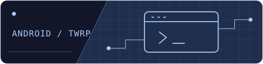
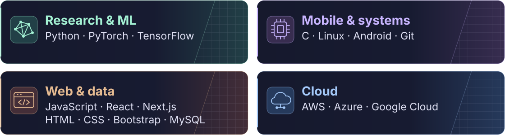

  
    
  
  
  

## About me

I’m a PhD candidate in machine learning at **Uppsala University**, with a background in computational materials discovery. Outside my research, I work on Android internals, port operating systems to phones, and build web apps. I also enjoy teaching and mentoring.

## Featured projects

<table width="100%">
  <tr>
    <td width="50%" valign="top">
      
      <h3><a href="https://github.com/open-mapple">Open Mapple</a></h3>
      
Bringing iOS to selected Android phones using Apple’s open-source XNU kernel and device-specific drivers.

      <a href="https://github.com/open-mapple/manifest">Source</a> · <a href="https://open-mapple.pages.dev/">Project docs</a>
    </td>
    <td width="50%" valign="top">
      
      <h3><a href="https://github.com/DrtSinX98/sagabond-oss">Sagabond OSS</a></h3>
      
The open-source UI for a travel planner that puts each stop and the journeys between them on one timeline.

      <a href="https://github.com/DrtSinX98/sagabond-oss">Source</a> · <a href="https://sagabond.site/">Live app</a>
    </td>
  </tr>
  <tr>
    <td width="50%" valign="top">
      
      <h3><a href="https://github.com/Los-FE/">Cyanide Project</a></h3>
      
A beautifully designed feature rich Android custom ROM project with the stability of Lineage OS.

      <a href="https://github.com/Los-FE/">Source</a>
    </td>
    <td width="50%" valign="top">
      
      <h3><a href="https://github.com/DrtSinX98/twrp_device_realme_spaced">TWRP for realme</a></h3>
      
TWRP recovery device tree for the realme 8i and Narzo 50, code-named <code>spaced</code>.

      <a href="https://github.com/DrtSinX98/twrp_device_realme_spaced">Device tree</a>
    </td>
  </tr>
</table>

## Tech stack

<picture>
  <source media="(max-width: 600px)" srcset="./assets/profile/tech-stack-narrow.svg" />
  
</picture>

## GitHub activity

  

GitHub stats, languages, and streak

 

  
   
  

   
  
  

